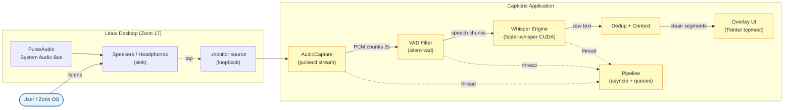
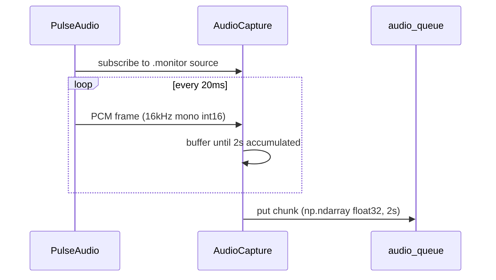
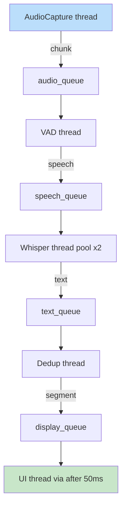
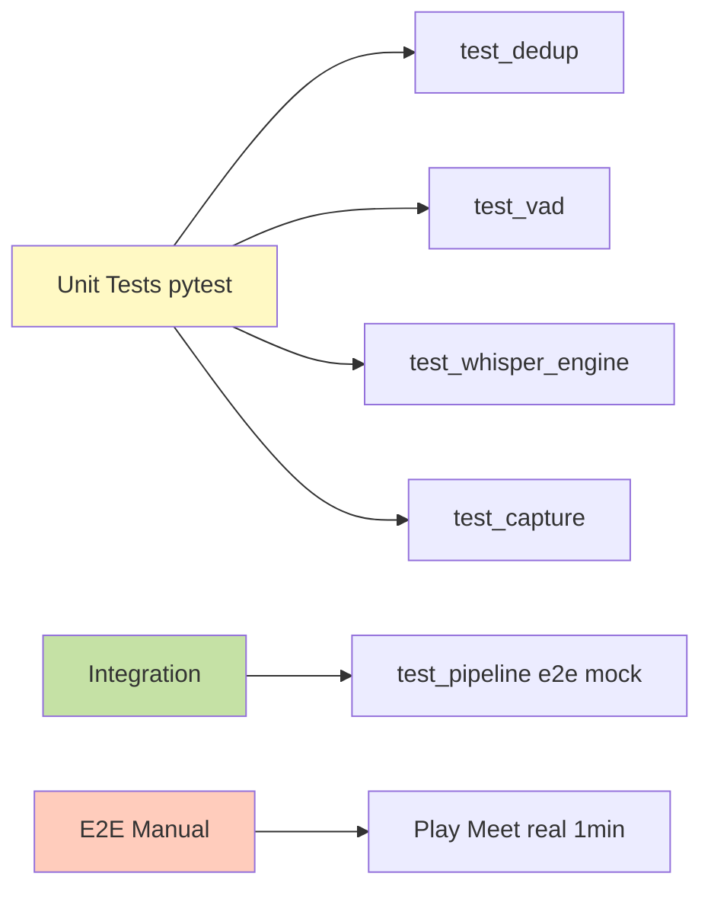

# Design — Captions: Real-Time Audio Transcriber

## 1. Vision

Aplicação desktop Linux que captura áudio do sistema (loopback PulseAudio) e mostra legendas em tempo real num overlay sempre no topo. Foco: **simples, rápido, offline**. Evolui pra tradutor depois.

## 2. Architecture Overview

C4 Level 2 — Container diagram:



## 3. Component Design

### 3.1 AudioCapture (`src/audio/capture.py`)

Responsabilidade: capturar PCM stream do `.monitor` source.



**API**:
```python
class AudioCapture:
    def __init__(self, source_name: str, sample_rate: int = 16000, chunk_seconds: float = 2.0)
    def start(self, output_queue: queue.Queue) -> None
    def stop(self) -> None
```

**Edge cases**:
- Source some/desconecta → reconecta automático
- Sem áudio por >10s → emite chunk silêncio (VAD filtra)

### 3.2 VAD Filter (`src/audio/vad.py`)

Silero VAD (ONNX, ~2MB) detecta fala. Filtra chunks só-silêncio antes de mandar pro Whisper.

```python
class VADFilter:
    def __init__(self, threshold: float = 0.5)
    def is_speech(self, audio: np.ndarray) -> bool
    def trim_silence(self, audio: np.ndarray) -> np.ndarray
```

### 3.3 Whisper Engine (`src/stt/whisper_engine.py`)

Wrapper `faster-whisper` com CUDA.

```python
class WhisperEngine:
    def __init__(self, model_size: str = "small.en", device: str = "cuda", compute_type: str = "float16")
    def transcribe(self, audio: np.ndarray, language: str = "en") -> Segment
    def warmup(self) -> None  # dummy inference pra evitar cold start lag
```

**Performance budget** (RTX 3060, small.en float16):
- 2s chunk → ~400ms infer → safe
- CPU fallback (tiny.en) → ~1.2s infer

### 3.4 Dedup (`src/stt/dedup.py`)

Fuzzy match com últimos N segmentos.

```python
class DedupBuffer:
    def __init__(self, max_history: int = 3, similarity_threshold: float = 0.7)
    def add(self, segment: Segment) -> Segment | None
        # returns None if duplicate, else normalized Segment
```

Algoritmo:
1. Compara novo texto vs últimos 3 com `difflib.SequenceMatcher`
2. Se ratio > 0.7 com qualquer → descarta
3. Se ratio 0.4-0.7 → extrai só o sufixo novo (overlap)
4. Caso contrário → aceita

### 3.5 Overlay UI (`src/ui/overlay.py`)

Tkinter `Toplevel` com `wm_attributes('-topmost', True)`. Fundo transparente (`-alpha` ou `transparentcolor`).

```python
class OverlayWindow:
    def __init__(self, font_size: int = 18, position: str = "bottom")
    def update_text(self, segment: Segment) -> None  # thread-safe via after()
    def toggle(self) -> None
    def run(self) -> None  # blocks, call in main thread
```

**Layout**:
- Posição: bottom-center, ~80% largura da tela, altura ~120px
- Texto: branco, sombra preta, fonte mono (JetBrains Mono se disponível)
- 2 linhas visíveis (linha anterior + atual), auto-scroll

### 3.6 Pipeline (`src/core/pipeline.py`)

Orquestra 3 threads + UI thread.



**Backpressure**: cada queue tem maxsize=10. Se Whisper lento, audio queue dropa chunks antigos.

### 3.7 Config (`src/core/config.py`)

CLI args via `argparse`:
- `--model {tiny.en,base.en,small.en,medium.en}` default `small.en`
- `--lang {en,pt,auto}` default `en`
- `--device {cuda,cpu,auto}` default `auto`
- `--source NAME` (PulseAudio source name, default: auto-detect sink monitor)
- `--no-overlay` (só loga no terminal)
- `--list-sources` (debug)

## 4. Data Flow

### 4.1 Segment Schema

```python
@dataclass(frozen=True)
class Segment:
    text: str           # "Hello everyone, today we'll..."
    start_ms: int       # timestamp no áudio
    end_ms: int
    confidence: float   # avg logprob normalizado
    language: str       # "en"
```

### 4.2 Audio Format

- Sample rate: 16000 Hz (Whisper requirement)
- Channels: 1 (mono)
- Dtype: float32, range [-1.0, 1.0]
- Chunk: 32000 samples = 2.0s

## 5. Error Handling

| Erro | Detecção | Recuperação |
|------|----------|-------------|
| PulseAudio não rodando | `pulsectl` connect fail | Exit com msg clara + troubleshooting |
| CUDA não disponível | `torch.cuda.is_available()` False | Fallback automático pra CPU |
| Modelo não baixado | first run | `huggingface_hub` download c/ progress bar |
| `.monitor` source sumiu | stream read retorna erro | Tenta recriar monitor source |
| Whisper exception | catch generic | Log + skip chunk, continua pipeline |
| UI crash (X11) | tk.Tk() exception | Retry init 3x, depois exit |

## 6. Testing Strategy



**Coverage target**: >80% core modules (pipeline, dedup, vad).

**Mock strategy**:
- Whisper: mock retorna Segment fixo baseado em hash do áudio
- AudioCapture: injeta PCM sintético (sine wave + silêncio)
- UI: nunca testada em unit (só manual), usa `xvfb` em CI se necessário

## 7. Deployment

Single-user desktop app. Não tem servidor.

### 7.1 Install (Zorin 17)

```bash
# System deps
sudo apt install -y python3.11 python3-pip python3-venv \
                    pulseaudio-utils libpulse-dev xdotool

# App
git clone <repo>
cd captions
./run.sh  # auto: cria venv, instala deps, baixa modelo, roda
```

### 7.2 Run

```bash
./run.sh                    # default settings
./run.sh --model tiny.en    # CPU
./run.sh --no-overlay       # CLI mode
./run.sh --list-sources     # debug áudio
```

### 7.3 Hotkeys

| Key | Action |
|-----|--------|
| Ctrl+Shift+T | Toggle overlay visibility |
| Ctrl+Shift+Q | Quit app |
| Ctrl+Shift+R | Reset history (clear dedup buffer) |

Detecção via `python-xlib` + `pynput` global listener rodando em thread separada.

## 8. Future Evolution → Translator

Pra adicionar tradução EN→PT:
1. Novo módulo `src/translate/argos_engine.py` (argostranslate, offline, ~200MB)
2. Insere entre `dedup` e `overlay`
3. Overlay ganha 2ª linha (original + tradução)
4. Whisper continua em `language="en"` forçado

Zero refactor dos módulos existentes.

## 9. Non-Goals (v1)

- Multi-usuário / rede
- Gravação em arquivo
- Tradução (v2)
- Captura de microfone (v2)
- Suporte macOS/Windows (Linux only v1)
- Mobile

## 10. Security & Privacy

- 100% offline: nenhum áudio sai da máquina
- Sem telemetria
- Sem network calls depois do download inicial do modelo
- Modelo Whisper = pesos públicos (MIT license)
- argostranslate = MIT (v2)
