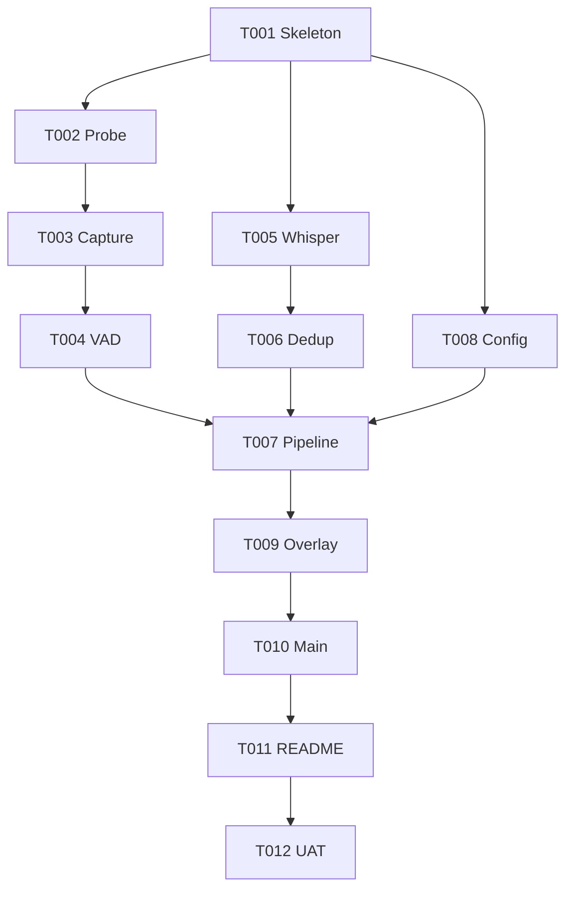

# Tasks — Captions: Real-Time Audio Transcriber

> Atomic tasks. Each task = one atomic commit.
> Branch: `feat/captions-v1`
> Verification: every task MUST pass its test before next starts.

## Phase 0 — Scaffolding

### T001 — Project skeleton + dependencies
**Files**: `pyproject.toml`, `src/captions/__init__.py`, `run.sh`, `README.md`, `.gitignore`, `.python-version`
**Verify**: `uv sync` succeeds; `python -c "import captions"` works
**Test**: `tests/test_skeleton.py` — assert package importable, version defined

### T002 — PulseAudio environment probe
**Files**: `src/captions/audio/__init__.py`, `src/captions/audio/probe.py`, `tests/test_probe.py`
**Goal**: Detect default sink + corresponding `.monitor` source
**Verify**: `python -m captions.audio.probe` lists sources; test mocks `pulsectl` and asserts correct `.monitor` name derivation
**Test**: `test_probe_finds_monitor_for_default_sink`, `test_probe_handles_no_pulse`

## Phase 1 — Audio Capture

### T003 — AudioCapture: stream loopback into 2s chunks
**Files**: `src/captions/audio/capture.py`, `tests/test_capture.py`
**Verify**: with mocked pulse stream, capture emits chunks of correct shape (32000 samples @ 16kHz)
**Test**: `test_chunk_shape`, `test_chunk_dtype_float32`, `test_stop_terminates_thread`

### T004 — VAD filter (Silero)
**Files**: `src/captions/audio/vad.py`, `tests/test_vad.py`
**Verify**: silence chunk → `is_speech=False`; sine wave chunk → `is_speech=True`
**Test**: `test_silence_detected`, `test_tone_detected`, `test_threshold_configurable`

## Phase 2 — STT Engine

### T005 — Whisper engine wrapper
**Files**: `src/captions/stt/__init__.py`, `src/captions/stt/whisper_engine.py`, `tests/test_whisper.py`
**Verify**: given known sample wav ("hello world"), engine returns text containing "hello"; falls back to CPU if no CUDA
**Test**: `test_transcribes_hello_world`, `test_cpu_fallback`, `test_language_param_passed`

### T006 — Dedup buffer (fuzzy)
**Files**: `src/captions/stt/dedup.py`, `tests/test_dedup.py`
**Verify**: exact duplicate rejected; partial overlap extracts suffix; fully new segment accepted
**Test**: `test_exact_duplicate_rejected`, `test_overlap_suffix_extracted`, `test_new_segment_accepted`, `test_history_bounded`

## Phase 3 — Pipeline Orchestration

### T007 — Pipeline: async producer/consumer chain
**Files**: `src/captions/core/__init__.py`, `src/captions/core/pipeline.py`, `src/captions/core/segment.py`, `tests/test_pipeline.py`
**Verify**: with all workers mocked, pipeline threads end-to-end: synthetic PCM → mock VAD → mock Whisper → dedup → display queue
**Test**: `test_end_to_end_flow`, `test_backpressure_drops_old_chunks`, `test_shutdown_clean`

### T008 — Config CLI
**Files**: `src/captions/core/config.py`, `tests/test_config.py`
**Verify**: argparse parses `--model`, `--lang`, `--device`, `--source`, `--no-overlay`, `--list-sources` correctly
**Test**: `test_default_values`, `test_model_choices`, `test_no_overlay_flag`, `test_list_sources_exits`

## Phase 4 — UI

### T009 — Overlay window (Tkinter topmost)
**Files**: `src/captions/ui/__init__.py`, `src/captions/ui/overlay.py`, `tests/test_overlay.py`
**Verify**: window object constructs without error (use `xvfb` in headless CI); `update_text` thread-safe via `after()`
**Test**: `test_overlay_constructs`, `test_update_text_queues`, `test_toggle_visibility`

## Phase 5 — Integration

### T010 — main.py wiring + global hotkeys
**Files**: `src/captions/main.py`, `tests/test_main.py`
**Verify**: `python -m captions` launches full app, listens for hotkeys (Ctrl+Shift+T toggle, Ctrl+Shift+Q quit), graceful shutdown on SIGINT
**Test**: `test_main_imports`, `test_hotkey_registration`, `test_sigint_shutdown`

### T011 — README + troubleshooting guide
**Files**: `README.md`
**Verify**: covers install (apt deps), CUDA setup, PipeWire fallback, common errors (no mic permission, no `.monitor` source)
**Test**: manual review

### T012 — End-to-end manual UAT script
**Files**: `docs/UAT.md`
**Verify**: script to run real Meet test (1 min meeting), save log, verify text appears with <2s latency
**Test**: manual run + sign-off

---

## Task Dependency Graph

## Acceptance Criteria (overall)

- [ ] `run.sh` single command launches app on Zorin 17
- [ ] Captures audio from Chrome (Meet) playing in parallel
- [ ] Overlay shows transcribed text <1.5s after speech
- [ ] No duplicate phrases (dedup works)
- [ ] Toggle hotkey works
- [ ] All unit tests pass (`pytest -q`)
- [ ] Clean shutdown on Ctrl+C
- [ ] Total venv size <3GB (model excluded)
- [ ] Model download progress visible on first run

## Out of Scope (deferred)

- Translation EN→PT (future v2 — design.md §8)
- Microphone capture (future v2)
- File export (future v2)
- macOS/Windows support (Linux only v1)
